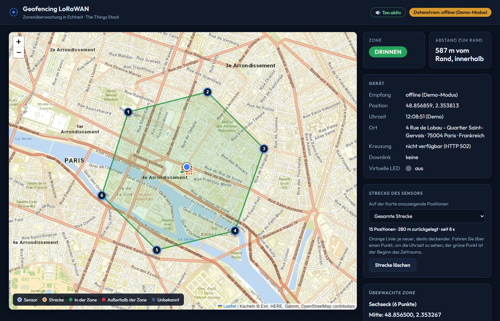

# Geofencing LoRaWAN

Überwachung eines Patienten in einer **Kontrollzone**: Die Position kommt von The Things Stack und wird auf einer Karte angezeigt, und ein **Alarm** (Bildschirm, Ton, SMS) wird ausgelöst, wenn der Patient seine Zone verlässt, und danach, wenn er zurückkehrt. Ohne Hardware lassen sich die Positionen simulieren.

> Dies ist die **deutsche Fassung** des Projekts (Oberfläche, SMS, Dokumentation und Code-Kommentare ausschließlich auf Deutsch). Die französische Originalfassung liegt im Repository `Arseine1/geolocalise`.



## Installation

> Ist dieses Repository **privat**, funktionieren die Ein-Zeilen-Befehle weiter unten nur mit einem Token. Wurden Sie als Mitarbeiter eingeladen, nutzen Sie eine dieser beiden Methoden:
>
> - **Ohne Kommandozeile**: Auf dieser GitHub-Seite den grünen Knopf **Code > Download ZIP**, entpacken, dann Doppelklick auf `Starten.bat` (Windows) oder `./starten.sh` (macOS, Linux).
> - **Mit git**: `git clone https://github.com/Arseine1/geolocalise-deutsch.git`, dann `cd geolocalise-deutsch` und `node start.js`. GitHub verlangt beim ersten Mal eine Anmeldung.
>
> In beiden Fällen muss zuerst **Node.js** (LTS-Version) von https://nodejs.org installiert werden. Beim ersten Start stellt ein Assistent einige Konfigurationsfragen (alles lässt sich mit Enter überspringen).

### Installation mit einem Befehl (öffentliches Repository oder Token)

Das einzige benötigte Programm ist **Node.js** (Version 18 oder neuer). Unter Windows bietet die Installation an, es für Sie zu installieren. Für Sprachnachrichten und das Diktat verwenden Sie **Google Chrome** (siehe „Nachrichten“).

**Windows**: *PowerShell* öffnen (Startmenü, „PowerShell“ eintippen), einfügen, dann Enter:

```powershell
irm https://raw.githubusercontent.com/Arseine1/geolocalise-deutsch/main/install.ps1 | iex
```

**macOS oder Linux**: das *Terminal* öffnen, einfügen, dann Enter:

```bash
curl -fsSL https://raw.githubusercontent.com/Arseine1/geolocalise-deutsch/main/install.sh | bash
```

Das Installationsprogramm:
1. prüft Node.js (und bietet unter Windows an, es zu installieren);
2. lädt das Projekt in den Ordner `geolocalise-deutsch` Ihres Benutzerordners herunter;
3. stellt einige Fragen zum Anlegen Ihrer Konfiguration (alles lässt sich mit Enter überspringen: Der Demo-Modus funktioniert ohne Schlüssel);
4. startet das Projekt und öffnet die Seite in Ihrem Browser.

### Weitere Installationsmöglichkeiten
- **Ohne Kommandozeile**: Auf der GitHub-Seite den grünen Knopf **Code > Download ZIP**, entpacken, dann Doppelklick auf `Starten.bat` (Windows) oder `./starten.sh` (macOS, Linux).
- **Mit git**:
  ```bash
  git clone https://github.com/Arseine1/geolocalise-deutsch.git
  cd geolocalise-deutsch
  node start.js
  ```

### Wenn das GitHub-Repository privat ist
Die obigen Befehle funktionieren nur, wenn das Repository **öffentlich** ist (ein privates Repository antwortet nicht angemeldeten Personen mit „404“). Zwei Möglichkeiten:
- **Das Repository öffentlich machen** (am einfachsten): GitHub > *Settings* > *General* > ganz unten, *Danger Zone* > *Change visibility*. Das Repository enthält keine Geheimnisse: `web/config.js`, `tools/sms-proxy.env`, `tools/sms-recipients.json` und `tools/voice.env` sind ausgeschlossen.
- **Das Repository privat lassen**: Legen Sie ein schreibgeschütztes Token an (GitHub > *Settings* > *Developer settings* > *Fine-grained tokens*, Zugriff „Contents: Read-only“ nur auf dieses Repository) und geben Sie es der Person, die installiert:
  ```powershell
  $env:GEO_TOKEN = "TOKEN-HIER-EINFUEGEN"
  irm -Headers @{ Authorization = "Bearer $env:GEO_TOKEN" } https://raw.githubusercontent.com/Arseine1/geolocalise-deutsch/main/install.ps1 | iex
  ```
  ```bash
  export GEO_TOKEN="TOKEN-HIER-EINFUEGEN"
  curl -fsSL -H "Authorization: Bearer $GEO_TOKEN" https://raw.githubusercontent.com/Arseine1/geolocalise-deutsch/main/install.sh | bash
  ```
- **Das Repository privat lassen, mit Mitarbeitern**: Auf GitHub *Settings* > *Collaborators* > *Add people*, den GitHub-Benutzernamen der Person eingeben. Sie nimmt die per E-Mail erhaltene Einladung an (7 Tage gültig) und installiert dann **ohne den Ein-Zeilen-Befehl** (der bei einem privaten Repository ohne Token nicht funktioniert):
  ```bash
  git clone https://github.com/Arseine1/geolocalise-deutsch.git
  cd geolocalise-deutsch
  node start.js
  ```
  `git clone` öffnet beim ersten Mal die GitHub-Anmeldeseite. Ohne git: auf der Seite des Repositorys, nach der Anmeldung, **Code > Download ZIP**, entpacken, dann Doppelklick auf `Starten.bat`.
  Achtung: Bei einem Repository eines persönlichen Kontos hat ein Mitarbeiter **Lese- und Schreibzugriff** (er kann den Code ändern oder löschen). Für reinen Lesezugriff nutzen Sie ein Token (vorherige Option) oder ein Organisations-Repository.

## Starten und Beenden
- **Starten**: Doppelklick auf `Starten.bat` (Windows), oder `node start.js` im Projektordner.
- **Beenden**: `Strg+C` im Fenster.
- **Adresse**: `http://localhost:8080/web/` (der Simulator: `http://localhost:8080/tools/simulate.html`, das simulierte Gerät: `http://localhost:8080/tools/sensor.html`).

## Installation ohne Fragen (Prototyp)
Liegt im Projektordner eine Datei **`voreinstellungen.env`** (Zeilen `KEY=VALUE`: `TTI_API_KEY`, `VONAGE_API_KEY`, `VONAGE_API_SECRET`, `SMS_FROM`, optional `TTI_HOST`, `APP_ID`, `DEVICE_ID`, `SMS_TO` …), stellt der Konfigurationsassistent **keine Fragen**: Ein Befehl installiert alles, am Ende genügt Enter zum Starten. Die Datei muss echte Schlüssel enthalten, wenn sie funktionieren soll, und gehört daher nur in ein Prototyp-Repository; vor einem echten Einsatz Schlüssel erneuern und die Datei löschen. Mit `node setup.js --ask --force` werden die Fragen trotzdem gestellt. Die Empfängernummer der SMS wird in der Seite unter „SMS-Alarme“ hinzugefügt.

## Was der Konfigurationsassistent fragt
Jederzeit mit `node setup.js --force` erneut startbar.

| Frage | Wozu | Wo zu finden |
|---|---|---|
| Adresse, Bereich, Anwendung, Gerät, Webhook | Verbindung zu The Things Stack | Konsole von The Things Stack |
| **API-Schlüssel** (Eingabe verdeckt) | Positionen empfangen, LED-Befehl senden | Konsole > Applications > API keys |
| Vonage: *API key* und *API secret* (optional) | SMS senden | Vonage-Dashboard |
| **Nummer**, die die SMS erhält | Empfänger der Alarme | Internationales Format: `+49 151 2345 6789` (später auch direkt in der Seite änderbar) |

Ohne Schlüssel für The Things Stack erlaubt der **Demo-Modus** (Kästchen „Offline-Demo-Modus“ in der Seite) trotzdem, alles auszuprobieren: Der Sensor wird mit der Maus bewegt. Ohne Vonage-Zugangsdaten werden SMS nur angezeigt („Testmodus“).

Die Geheimnisse werden **nur auf Ihrem Computer** gespeichert, in `web/config.js`, `tools/sms-proxy.env` und `tools/voice.env` (Token des Geräts, erzeugt, ohne angezeigt zu werden); die in der Seite eingegebenen Empfängernummern liegen in `tools/sms-recipients.json`. Diese Dateien sind von git ausgeschlossen und werden nie veröffentlicht.

## Zone aus einer Adresse zeichnen
Im Abschnitt „Überwachte Zone“ der Seite: eine Adresse eingeben (ohne Koordinaten), auf **Suchen** klicken: Der Punkt wird auf der Karte gesetzt und die Zone darum gezeichnet. Der **Radius** (50 m bis 5 km, 500 m standardmäßig) lässt sich mit Feld oder Regler einstellen. Die Adresse wird dazu an den Dienst Nominatim (OpenStreetMap) gesendet.

## Nachrichten
Das Gerät hat **weder Tastatur noch Bildschirm**: Es empfängt Töne und sendet nur Töne.
- **Seite zum Gerät**: ein **Text** (höchstens 49 Byte, einer pro Minute), der per LoRaWAN hinausgeht und den das Gerät in Sprache umwandelt, oder eine **Sprachnachricht** (höchstens 10 s, grünes Mikrofon der Seite): Das Gerät wird per LoRaWAN benachrichtigt und lädt das Audio per WLAN herunter. Vom Patienten empfangene Sprachnachrichten werden **automatisch abgespielt**.
- **Gerät zur Seite**: ausschließlich **Sprachnachrichten**, per WLAN über ein Relay des PCs (die Stimme läuft nie über LoRaWAN).
- **Ohne Hardware**: Öffnen Sie die Seite des simulierten Geräts `http://localhost:8080/tools/sensor.html` (Karte, Position, Mikrofon, Nachrichten) neben der Hauptseite.

Die Nachrichten bleiben auf Ihrem Computer (`data/voice/`, standardmäßig 7 Tage): sensible Daten. Nur das Diktat (Chrome) sendet die Stimme an Google; Schreiben mit der Tastatur bleibt zu 100 % lokal. Einzelheiten, Sicherheit und Testablauf: [docs/SPRACHNACHRICHTEN.md](docs/SPRACHNACHRICHTEN.md). Automatischer Test: `node tools/test-voice.js`. Die Firmware ist auf Hardware nicht getestet.

**Was nötig ist, damit die Nachrichten funktionieren**
- **Chrome** und die Adresse `http://localhost:8080` (nicht die IP-Adresse des PCs, keine geöffnete Datei): Mikrofon und Diktat verlangen das. Das Diktat braucht außerdem Internet.
- **Sprachsynthese** (Text in Sprache umgewandelt): unter Windows (System.Speech) und macOS (`say`) enthalten; unter Linux `espeak-ng` installieren. Ohne Engine greift die Seite des simulierten Geräts auf die Stimme des Browsers zurück.
- **Konsole von The Things Stack**: Kopieren Sie `ttn/uplink_decoder.js` (Tab *Uplink*) und `ttn/downlink_encoder.js` (Tab *Downlink*) in *Payload formatters* des Geräts, und geben Sie dem API-Schlüssel das Recht *Write uplink application traffic* (nötig für die Seite des simulierten Geräts).
- **Echtes Gerät** (später): `VOICE_LAN=1` in `tools/voice.env` (über `node setup.js --force`), den Port 8081 in der Firewall erlauben und das Token aus `tools/voice.env` in `secrets.h` der Firmware übernehmen. Dieser Modus nutzt unverschlüsseltes HTTP: nur für ein vertrauenswürdiges Netz.

## Aktualisieren
Führen Sie denselben Installationsbefehl erneut aus: Der Code wird ersetzt, **Ihre Schlüssel, Nummern und Nachrichteneinstellungen bleiben erhalten** (`web/config.js`, `tools/sms-proxy.env`, `tools/voice.env`, `tools/sms-recipients.json`, `secrets.h`), ebenso die bereits gespeicherten Nachrichten. Hat sich der Ordner `ttn/` geändert, **kopieren Sie Decoder und Encoder erneut** in die Konsole von The Things Stack.

## Deinstallieren
Löschen Sie den Ordner `geolocalise-deutsch` (das löscht auch die in `data/voice/` gespeicherten Nachrichten). Sonst ist nichts installiert (außer Node.js, falls Sie es akzeptiert haben).

## Häufige Probleme
| Symptom | Lösung |
|---|---|
| „Node.js ist nicht installiert“ | Installieren Sie die LTS-Version von https://nodejs.org und starten Sie dann neu. |
| Fehler 404 beim Download | Das GitHub-Repository muss **öffentlich** sein, und die Adresse genau stimmen. |
| Die Seite öffnet sich nicht | Öffnen Sie `http://localhost:8080/web/` von Hand. Ist der Port belegt, `node start.js --port 8090`. |
| „Proxy offline“ (Abschnitt SMS) | Der Port 3001 ist vielleicht belegt: mit `node start.js` neu starten, oder `SMS_PROXY_PORT` über `node setup.js --force` ändern. |
| Karte ohne Hintergrund | Kein Internetzugang oder Kachelanbieter gesperrt: siehe `web/config.js` (TILE_URL). |
| Kein Ton | Chrome verlangt einen Klick auf die Seite: Klicken Sie darauf oder auf die Anzeige „Ton aus“. |
| „Sprach-Relay offline“ | Die Seite muss von `node start.js` ausgeliefert werden (nicht von einem anderen Server und nicht als geöffnete Datei). |
| Die Nachrichten gehen nicht hinaus | Limit von 20 Sprachnachrichten und 200 Texten pro Stunde; ohne echtes Gerät antwortet die Plattform „no_device_session“: Öffnen Sie `tools/sensor.html`, um das Gerät zu simulieren. |
| Fehler 400 „settings“ beim Simulieren eines Uplinks | Alte Simulationsseite: mit Strg+F5 neu laden. |
| Mikrofon abgelehnt oder nicht verfügbar | Öffnen Sie die Seite mit Chrome unter `http://localhost:8080/web/` und erlauben Sie das Mikrofon (Symbol links von der Adresse). |
| Keine SMS erhalten | Lesen Sie die Meldung unter der Schaltfläche „Test-SMS senden“; siehe `docs/SMS_VONAGE.md`. |

## Inhalt des Ordners
| Ordner oder Datei | Aufgabe |
|---|---|
| `setup.js`, `start.js`, `install.ps1`, `install.sh`, `Starten.bat`, `starten.sh` | Installation und Start |
| `web/` | Die Seite: Karte, Zone, Alarme (`config.example.js` = Konfigurationsvorlage) |
| `tools/` | Positions-Simulator, Seite des simulierten Geräts (`sensor.html`), SMS-Versand, Sprach-Relay und Sprachsynthese, lokaler Webserver, Tests |
| `ttn/` | Decoder und Encoder für The Things Stack |
| `firmware/` | Code des echten Geräts (Heltec WiFi LoRa 32 V3 + GPS) |
| `docs/` | Anleitungen: Konfiguration der Plattform, Test, technische Erklärung, SMS, Nachrichten, PDF-Zusammenfassung |

## Sicherheit
- Der Schlüssel von The Things Stack ist **in der Seite lesbar**: nur für den lokalen Gebrauch, veröffentlichen Sie die Seite nicht im Internet, und **widerrufen Sie den Schlüssel nach der Vorführung**.
- Das Vonage-Geheimnis bleibt im kleinen lokalen Programm (`tools/sms-proxy.js`), das nur auf Ihrem Computer lauscht.
- Die Position einer Person ist ein sensibles Datum: siehe `docs/ZUSAMMENFASSUNG_PROJEKT.pdf` (Abschnitt Sicherheit und Datenschutz).

## Dokumentation
- [Konfiguration von The Things Stack](docs/CONFIG_TTI.md)
- [Testanleitung ohne Hardware](docs/TESTANLEITUNG.md)
- [Technische Erklärung](docs/PROJEKTERKLAERUNG.md)
- [SMS-Alarme mit Vonage](docs/SMS_VONAGE.md)
- [Text- und Sprachnachrichten](docs/SPRACHNACHRICHTEN.md)
- [Code des Geräts](firmware/README.md)
- [Projektzusammenfassung (PDF)](docs/ZUSAMMENFASSUNG_PROJEKT.pdf)
